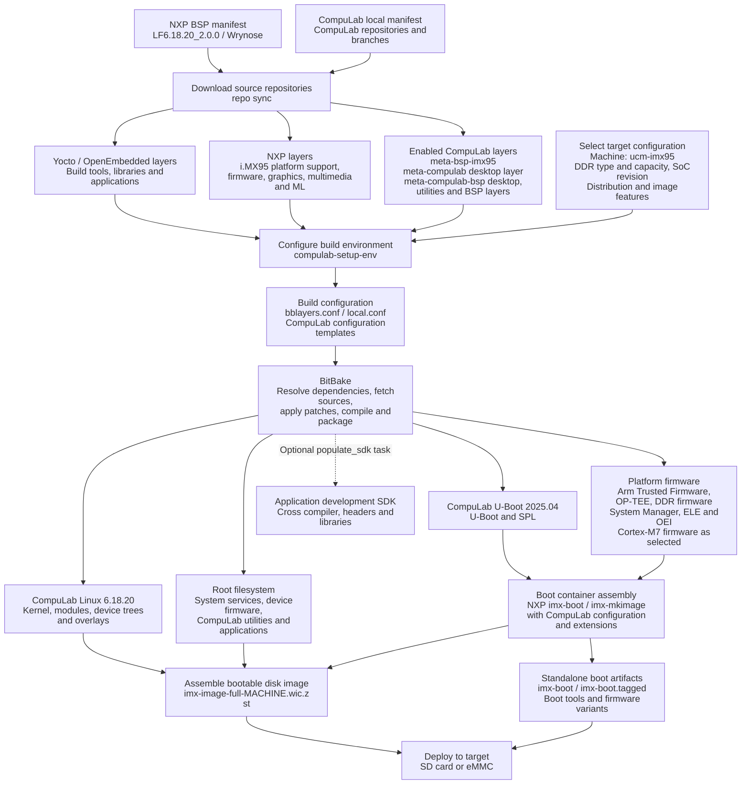

# CompuLab i.MX95 BSP Build Flow

This document describes the source-level build flow of the local
`meta-bsp-imx95` layer, branch `wrynose-6.18.20-2.0.0`, reviewed with HEAD at
`847707e0e29bf2f547738da9a9c032c4eb848519`.
It also considers the connected layers and configuration in the current
`build-ucm-imx95` workspace. The layer's [README](../README.md) identifies the
branch as a development branch. Creating this document did not include a new
image build or hardware validation.

## Overview

CompuLab extends the NXP Linux BSP with board-specific kernel, bootloader,
device-tree, firmware, and system integration. Yocto and BitBake combine these
components into a bootable Linux image and an optional application development
SDK.

The diagram uses UCM-iMX95 as its example target.

## Block Diagram



## Component Responsibilities

| Component | Role in this BSP |
|---|---|
| NXP manifest | Selects the NXP BSP release and its repositories |
| CompuLab local manifest | Adds CompuLab repositories and the setup helper |
| `meta-bsp-imx95` | Supplies machine configuration, CompuLab kernel and U-Boot recipes, device-tree selections, and boot integration |
| Shared CompuLab layers | Supply desktop integration, common utilities, firmware packaging, and BSP functionality |
| NXP `imx-boot` recipe | Assembles the boot container from U-Boot and platform firmware, with CompuLab extensions |
| BitBake | Builds packages and assembles the selected image and optional SDK |

The [CompuLab manifest](../scripts/meta-bsp-imx95.xml) adds `meta-compulab`,
`meta-compulab-bsp`, `meta-compulab-uefi`, and `meta-bsp-imx95` to the source
checkout. Downloading a repository does not automatically enable it as a build
layer: the current [layer templates](../templates/bblayers.conf/) enable the
CompuLab layers shown in the diagram, together with Chromium. They do not enable
`meta-compulab-uefi`.

The [setup helper](../tools/compulab-setup-env) initializes the NXP build environment
and applies the CompuLab templates when creating a new build directory. These
templates configure the enabled layers and additional image packages. For an
existing build directory, the helper re-enters its environment without
reapplying the templates.

The [provider configuration](../conf/machine/include/compulab-default.inc) selects
`linux-compulab` and `u-boot-compulab`. The current
[version selection](../conf/machine/include/u-boot_2025.04.inc) prefers U-Boot
2025.04 and matching selections for System Manager, ELE firmware, and OP-TEE.

Unlike the i.MX8MP flow described in the companion document, this configuration
uses a separate NXP `imx-boot` recipe for boot container assembly. The
[CompuLab append](../recipes-bsp/imx-mkimage/imx-boot_%.bbappend) adds deployment
tools, Cortex-M7 firmware handling, and variant-specific artifact links.

## Standard Build

After synchronizing the NXP and CompuLab repositories using the procedure in
the layer's README, configure and build UCM-iMX95 with:

```bash
export MACHINE=ucm-imx95
source compulab-setup-env build-${MACHINE}

bitbake imx-image-full
```

The image artifacts are deployed under:

```text
build-ucm-imx95/tmp/deploy/images/ucm-imx95/
```

The boot container can also be built separately:

```bash
bitbake imx-boot
```

The current workspace provides `imx-boot` and `imx-boot.tagged`, along with
variant-specific boot containers and an `imx-boot-tools` directory. Use the
actual deployed filenames when preparing deployment commands.

The SDK is a separate build task:

```bash
bitbake imx-image-full -c populate_sdk
```

SDK artifacts are deployed under `build-ucm-imx95/tmp/deploy/sdk/`.

## Target Configuration

The [common machine configuration](../conf/machine/compulab-imx95.inc) and
[UCM-iMX95 configuration](../conf/machine/ucm-imx95.conf) define the hardware inputs.
Settings can be overridden in the build directory's `conf/local.conf`.

| Setting | Purpose | Current default or selection |
|---|---|---|
| `MACHINE` | Target board | `ucm-imx95` in the setup helper |
| `DISTRO` | Distribution and graphics environment | `fsl-imx-xwayland` in the setup helper |
| `DDR_TYPE` | Selects DDR firmware and OEI board configuration | `lpddr5`; `lpddr4x` is also defined |
| `DRAM_CONF` | DRAM capacity configuration | `D8`; the README also documents `D4` and `D16` |
| `IMXBOOT_VARIANT` | Selects System Manager configuration | `mx95cpl`, or `mx95cplrpmsg` when the value is `rpmsg` |
| `M4_DEFAULT_IMAGE_MX95` | Selects Cortex-M7 firmware despite the historical variable name | Power-mode-switch demo firmware |

For example, an LPDDR4X variant uses:

```bitbake
DDR_TYPE = "lpddr4x"
```

The current machine configuration reads `DDR_TYPE`; the `DRAM_TYPE` spelling
in the README's DRAM-type table does not match this implementation.

The UCM machine also selects the Summit NX61x firmware package, wireless driver
autoload settings, and the board's device trees and overlays.

## Suggested Diagram Caption

> **CompuLab i.MX95 BSP build flow:** CompuLab extends the NXP Linux BSP with
> board-specific kernel, bootloader, device-tree, firmware, and system
> configuration. Yocto and BitBake build these components, assemble the i.MX95
> boot container, and generate a bootable Linux image and an optional application
> development SDK.
