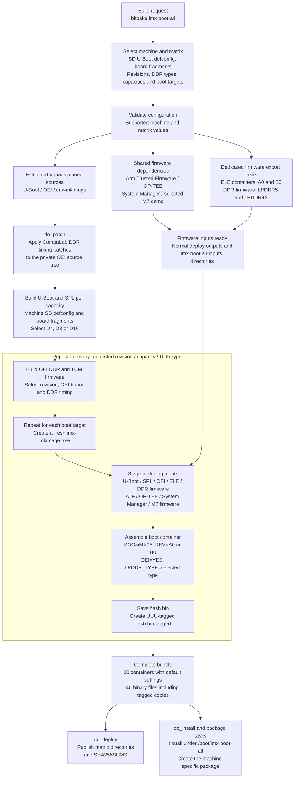

# CompuLab imx-boot-all Build Flow

The [imx-boot-all recipe](../recipes-bsp/imx-mkimage/imx-boot-all.bb) builds a
complete boot container matrix for the selected CompuLab i.MX95 machine in one
BitBake invocation. It uses private source and build directories, without
multiconfig or nested BitBake commands.

```bash
bitbake imx-boot-all
```

The recipe supports the `compulab-mx95` family: currently `ucm-imx95` and
`mcm-imx95-sbc`. One invocation builds the matrix for one selected machine.
`ucm-imx952` belongs to a different SoC family and is excluded.

## Block Diagram



The arrows show data dependencies. BitBake may build independent firmware
dependencies in parallel or restore them from shared state. The matrix loop
inside `do_compile` processes variants sequentially; individual make commands
use BitBake's configured build parallelism.

## Default Build Matrix

| SoC revisions | DDR type | DRAM capacities | Hardware combinations |
|---|---|---|---:|
| A0, B0 | LPDDR5 | D4, D8, D16 | 6 |
| A0, B0 | LPDDR4X | D4, D8 | 4 |

Each of the ten combinations is assembled for two targets:

| Target | M7 behavior |
|---|---|
| `flash_all` | Embeds and starts the selected M7 firmware during boot |
| `flash_lpboot_sm_a55` | Leaves M7 under U-Boot/Linux control |

Default build totals, per machine:

- Three U-Boot/SPL builds, one for each capacity, reused across revisions and DDR types.
- Ten OEI DDR/TCM pairs, one pair per hardware combination.
- Twenty boot container assemblies, one per combination and boot target.
- Forty binary output files: twenty `flash.bin` and twenty `flash.bin.tagged`.

LPDDR4X D16 is excluded because the current layer does not provide its DDR
timing configuration.

## Task and Function Responsibilities

| Task or function | Responsibility |
|---|---|
| Anonymous recipe Python | Validates the requested matrix and U-Boot defconfig selection during parsing |
| `do_fetch` / `do_unpack` | Prepare independent pinned U-Boot, OEI, and imx-mkimage source trees |
| Standard Yocto `do_patch` | Applies the three CompuLab timing patches in `SRC_URI` order to OEI |
| Firmware `do_deploy_boot_matrix` tasks | Export both ELE revisions and both DDR firmware types through separate sstate-managed directories |
| `boot_matrix_uboot()` | Applies the selected machine's U-Boot configuration and builds one capacity |
| `boot_matrix_variant()` | Builds the selected OEI pair, assembles both requested targets, and creates tagged copies |
| `boot_matrix_copy()` | Checks that an input exists and is nonempty before staging it |
| `do_deploy` | Publishes the bundle and generates checksums |
| `do_install` and packaging tasks | Package the binary matrix under `/boot/imx-boot-all/` |

`do_configure` is disabled for this recipe. U-Boot configuration is performed
inside `boot_matrix_uboot()` during `do_compile`, separately for each capacity.

## Source Preparation and Patch Application

The recipe unpacks three sibling source trees:

```text
${UNPACKDIR}/
├── uboot/       ← ${S}
├── oei/
└── mkimage/
```

The OEI patch entries use `patchdir=../oei`. Yocto resolves that path relative
to `${S}`, so the patches are applied to `${UNPACKDIR}/oei`. The timing patches
are applied once before the matrix compilation begins.

UCM-iMX95 uses its SD U-Boot defconfig. MCM-iMX95-SBC reuses the UCM defconfig
and applies `mcm-imx95.cfg` and `mcm-imx95-sbc.cfg`, which select the MCM prompt
and default device-tree filename.

## Shared and Variant Inputs

| Input | Selection and reuse |
|---|---|
| U-Boot and SPL | Built per capacity using the selected machine's configuration |
| OEI DDR and TCM | Built per revision, capacity, and DDR type |
| ELE container | Selected by SoC revision: `mx95a0` or `mx95b0` |
| DDR training firmware | Selected by DDR type; both types are exported by the helper task |
| Arm Trusted Firmware and OP-TEE | Shared across the matrix, from the normal firmware recipes |
| System Manager | Shared across the matrix, using the current build's System Manager configuration |
| M7 firmware | Shared selected demo; embedded by `flash_all` |

The helper tasks are defined in the
[ELE firmware append](../recipes-bsp/firmware-imx/firmware-ele-imx_%.bbappend)
and [DDR firmware append](../recipes-bsp/firmware-imx/imx-boot-firmware-files_%.bbappend).
They are requested explicitly by this bundle and do not change normal firmware
deployment behavior.

## Output Layout

Each machine has a separate deployment directory:

```text
tmp/deploy/images/${MACHINE}/imx-boot-all/
├── SHA256SUMS
├── A0/
│   ├── D4/
│   │   ├── lpddr5/
│   │   │   ├── flash_all/
│   │   │   │   ├── flash.bin
│   │   │   │   └── flash.bin.tagged
│   │   │   └── flash_lpboot_sm_a55/
│   │   │       ├── flash.bin
│   │   │       └── flash.bin.tagged
│   │   └── lpddr4x/...
│   ├── D8/...
│   └── D16/lpddr5/...
└── B0/...
```

The corresponding package installs the same binary hierarchy under
`/boot/imx-boot-all/`. This target does not replace the normal `imx-boot`
artifacts or automatically add the bundle to a root filesystem image.

## Validation and Usage

Full builds have passed for both `ucm-imx95` and `mcm-imx95-sbc`. The generated
matrix, checksums, and UUU tags were verified, as were the MCM prompt and default
device-tree strings. Hardware boot and memory testing remain necessary for
each board configuration.

See [Build the CompuLab i.MX95 Boot Container Matrix](imx-boot-all.md) for build
commands, subset selection, output verification, and source-pin maintenance.

## Suggested Diagram Caption

> **CompuLab imx-boot-all build flow:** One BitBake target builds boot containers
> for the selected i.MX95 machine across the supported SoC revisions, DRAM
> capacities, and DDR types. Shared platform firmware is combined with
> capacity-specific U-Boot and variant-specific OEI firmware in isolated image
> assembly directories, then deployed and packaged as one boot container bundle.
